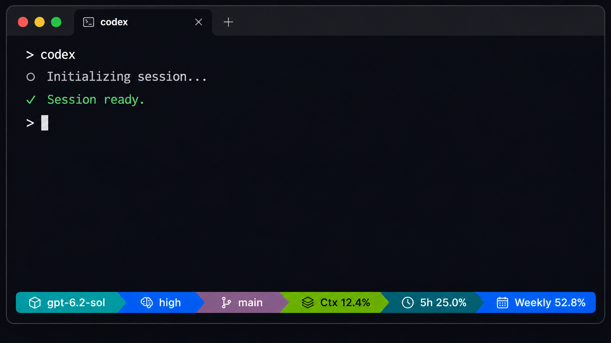

<div align="center">

# 

**An extension for the OpenAI Codex CLI that adds a customizable Powerline status bar.**

[ccstatusline](https://github.com/sirmalloc/ccstatusline), rewritten for Codex.
See your model, context, usage limits, and Git state with flexible layouts,
themes, and a live configuration preview.

**Also supported in**

<a href="https://github.com/powerline-dev/codex-powerline-vscode"> VS Code</a> &nbsp; · &nbsp; <a href="https://github.com/powerline-dev/codex-powerline-visualstudio"> Visual Studio</a>

One Powerline CLI. The same layouts, themes, and widgets across all three hosts.

Give a ⭐ if this project helped you!

[](https://github.com/powerline-dev/codex-powerline-cli)
[](https://github.com/powerline-dev/codex-powerline-cli/forks)
[](https://github.com/powerline-dev/codex-powerline-cli)

[](https://www.npmjs.com/package/@powerline-dev/codex-powerline-cli)
[](https://www.npmjs.com/package/@powerline-dev/codex-powerline-cli)
[](LICENSE)
[](https://bun.sh/)
[](https://nodejs.org/)

[](https://github.com/powerline-dev/codex-powerline-cli/issues)
[](https://github.com/powerline-dev/codex-powerline-cli/pulls)
[](https://github.com/powerline-dev/codex-powerline-cli/graphs/contributors)



</div>

## 📥 Install

The commands below apply after `@powerline-dev/codex-powerline-cli` is released on npm.
For now, use the [development setup](docs/development.md). The executable name and
settings path are unchanged.

If you still have the former unscoped package installed, it uses the same
`codex-powerline` command. Use separate npm prefixes to keep both installs.

### 🪟 Windows

**📦 Install and launch**

Install [Node.js 22.12 or newer](https://nodejs.org/en/download) if needed.
Open PowerShell and paste this block. Sign in, then save and exit the editor.

```powershell
npm install --global @openai/codex @powerline-dev/codex-powerline-cli
codex login
codex-powerline configure
codex-powerline run
```

**🔄 Update**

```powershell
npm install --global @powerline-dev/codex-powerline-cli@latest
```

**🧹 Uninstall**

```powershell
npm uninstall --global @powerline-dev/codex-powerline-cli
```

If PowerShell blocks scripts, paste the same commands into Command Prompt.
If the separators look like boxes, try a Nerd Font in Windows Terminal.

### 🍎 macOS

**📦 Install and launch**

Install [Node.js 22.12 or newer](https://nodejs.org/en/download) if needed.
Open Terminal and paste this block. Sign in, then save and exit the editor.

The package includes a Nerd Font and installs it automatically. In Apple
Terminal, setup selects it for your current profile; allow Terminal automation
if macOS asks. Other terminal apps may require selecting the font in settings.

```sh
npm install --global @openai/codex @powerline-dev/codex-powerline-cli
codex login
codex-powerline configure
codex-powerline run
```

**🔄 Update**

```sh
npm install --global @powerline-dev/codex-powerline-cli@latest
```

**🧹 Uninstall**

```sh
npm uninstall --global @powerline-dev/codex-powerline-cli
```

### 🐧 Linux

**📦 Install and launch**

Install [Node.js 22.12 or newer](https://nodejs.org/en/download) if needed.
Open a terminal and paste this block. Sign in, then save and exit the editor.

```sh
npm install --global @openai/codex @powerline-dev/codex-powerline-cli
codex login
codex-powerline configure
codex-powerline run
```

**🔄 Update**

```sh
npm install --global @powerline-dev/codex-powerline-cli@latest
```

**🧹 Uninstall**

```sh
npm uninstall --global @powerline-dev/codex-powerline-cli
```

Uninstalling Powerline keeps Codex CLI, your saved layout, and installed fonts.

## ✨ Features

- 🎨 **Make it yours.** Stack rows, pick a theme, and tweak colors and separators with a live preview.
- ⏱️ **Know what’s left.** See context usage and your 5-hour and weekly limits at a glance.
- 🧠 **See what Codex is using.** Show the active model, reasoning effort, token counts, and cache stats.
- 🌿 **Stay oriented.** Show your working folder, Git or Jujutsu status, and Codex workspace and permissions.
- 📦 **Take your layout with you.** Export your setup as JSON and import it on another machine.

Import [Author’s Favorite](configTemplates/authors-favorite.json) for a Minimal theme layout with a working-folder row and four aligned columns. Widgets reserve space when data is missing.

## ⚙️ Configure

Choose your widgets, rows, and theme in the live editor:

```sh
codex-powerline configure
```

Save your layout, then launch `codex-powerline run`. The IDE extensions use
the same saved layout after **Restart Terminal**.

### Configure with Codex

The [Configure Powerline skill](.agents/skills/codex-powerline-configure/)
turns a description of your status bar into a saved layout and a preview.
It works with the npm install on Windows, macOS, and Linux. No repository
checkout, interactive Powerline editor, or MCP server is needed.

1. [Install Powerline](#-install) if needed. Skip `codex-powerline configure`.
2. In Codex, download the skill by asking:

   > Use `$skill-installer` to install the skill from
   > https://github.com/powerline-dev/codex-powerline-cli/tree/main/.agents/skills/codex-powerline-configure

3. In your next Codex message, describe your layout:

   > Use `$codex-powerline-configure` to make a two-row layout with my model,
   > reasoning effort, Git branch, and usage limits.

Codex saves the layout separately and gives you the launch command. Add
“make it my default” if you want `codex-powerline run` to use it automatically.

## 🤝 Contributing

Contributions are welcome! Open an issue, suggest a feature, or send a focused
pull request. See the [development guide](docs/development.md) for setup,
checks, and release preparation.

## Author and acknowledgments

**Martin Hájek** is the author and maintainer of Codex Powerline.

Based on [ccstatusline](https://github.com/sirmalloc/ccstatusline), created
by Matthew Breedlove, and rewritten for the OpenAI Codex CLI. See
[NOTICE](NOTICE) for the upstream attribution and [CHANGELOG.md](CHANGELOG.md)
for release history.

## License

MIT. See [LICENSE](LICENSE) for the terms and copyright notices.
